# Community Events Board

A small app where an admin posts local events and visitors browse, filter,
favourite categories, set reminders and design a shareable event card.

**Stack:** Next.js (App Router), Prisma, SQLite, Tailwind CSS, JWT auth.

---

## Architecture

```mermaid
%% Generated by https://gitdiagram.com/pprathik07/community-events-board
flowchart TD

subgraph group_web["Web experience"]
  node_browse["Event browsing<br/>[page.tsx]"]
  node_detail["Event details<br/>[page.tsx]"]
  node_accountpages["Account pages<br/>[page.tsx]"]
  node_feedpage["My Feed<br/>[page.tsx]"]
  node_favpage["Favourites<br/>[page.tsx]"]
  node_designer["Card designer<br/>[card-designer.tsx]"]
  node_adminpages["Event management<br/>[page.tsx]"]
end

subgraph group_api["JSON API"]
  node_eventsapi["Public event routes<br/>[route.ts]"]
  node_detailapi["Event detail route<br/>[route.ts]"]
  node_filtersapi["Filter values route<br/>[route.ts]"]
  node_reminderapi["Reminder route<br/>[route.ts]"]
  node_cardapi["Card design route<br/>[route.ts]"]
  node_authapi["Authentication routes<br/>[route.ts]"]
  node_userapi["User data routes<br/>[route.ts]"]
  node_adminapi["Admin event routes<br/>[route.ts]"]
end

subgraph group_domain["Domain services"]
  node_authsvc["Account service<br/>[auth.ts]"]
  node_eventsvc["Event service<br/>[events.ts]"]
  node_visibility["Event visibility<br/>[visibility.ts]"]
  node_favourites["Favourite service<br/>[favourites.ts]"]
  node_feed["Feed service<br/>[feed.ts]"]
  node_reminders["Reminder service<br/>[reminders.ts]"]
end

subgraph group_foundation["Shared foundation"]
  node_db[("Prisma database<br/>[db.ts]")]
  node_session["Session guards<br/>[session.ts]"]
  node_jwt["JWT handling<br/>[jwt.ts]"]
  node_validation["Input validation<br/>[validation.ts]"]
  node_http["HTTP helpers<br/>[http.ts]"]
  node_api_client["API client<br/>[api.ts]"]
  node_sessionhook["Session hook<br/>[use-session.ts]"]
end

node_visitor(("Visitors"))
node_admin(("Admins"))

node_visitor -->|"browses"| node_browse
node_visitor -->|"signs in"| node_accountpages
node_visitor -->|"opens"| node_detail
node_visitor -->|"views feed"| node_feedpage
node_visitor -->|"sets categories"| node_favpage
node_admin -->|"manages events"| node_adminpages
node_browse -->|"requests events"| node_eventsapi
node_browse -->|"requests filters"| node_filtersapi
node_detail -->|"loads event"| node_detailapi
node_detail -->|"sets reminder"| node_reminderapi
node_detail -->|"offers design"| node_designer
node_designer -->|"saves design"| node_cardapi
node_accountpages -->|"authenticates"| node_authapi
node_feedpage -->|"loads feed"| node_userapi
node_favpage -->|"manages categories"| node_userapi
node_adminpages -->|"manages events"| node_adminapi
node_eventsapi -->|"lists events"| node_eventsvc
node_adminapi -->|"creates or lists"| node_eventsvc
node_authapi -->|"signs up"| node_authsvc
node_authsvc -->|"reads and writes"| node_db
node_eventsvc -->|"queries events"| node_db
node_eventsvc -->|"uses rules"| node_visibility
node_session -->|"checks token"| node_jwt
node_eventsapi -->|"parses filters"| node_validation
node_adminapi -->|"requires admin"| node_session
node_adminapi -->|"validates input"| node_validation
node_authapi -->|"validates signup"| node_validation
node_authapi -->|"formats response"| node_http
node_authapi -.->|"serves JSON API"| node_api_client
node_sessionhook -->|"loads session"| node_api_client
node_designer -->|"checks session"| node_sessionhook
node_userapi -.->|"manages choices"| node_favourites
node_userapi -.->|"builds feed"| node_feed
node_reminderapi -.->|"stores reminders"| node_reminders

click node_browse "https://github.com/pprathik07/community-events-board/blob/main/src/app/page.tsx"
click node_detail "https://github.com/pprathik07/community-events-board/blob/main/src/app/events/%5Bid%5D/page.tsx"
click node_accountpages "https://github.com/pprathik07/community-events-board/blob/main/src/app/login/page.tsx"
click node_feedpage "https://github.com/pprathik07/community-events-board/blob/main/src/app/feed/page.tsx"
click node_favpage "https://github.com/pprathik07/community-events-board/blob/main/src/app/favourites/page.tsx"
click node_designer "https://github.com/pprathik07/community-events-board/blob/main/src/components/card-designer.tsx"
click node_adminpages "https://github.com/pprathik07/community-events-board/blob/main/src/app/admin/(protected)/events/new/page.tsx"
click node_eventsapi "https://github.com/pprathik07/community-events-board/blob/main/src/app/api/events/route.ts"
click node_detailapi "https://github.com/pprathik07/community-events-board/blob/main/src/app/api/events/%5Bid%5D/route.ts"
click node_filtersapi "https://github.com/pprathik07/community-events-board/blob/main/src/app/api/events/filters/route.ts"
click node_reminderapi "https://github.com/pprathik07/community-events-board/blob/main/src/app/api/events/%5Bid%5D/reminder/route.ts"
click node_cardapi "https://github.com/pprathik07/community-events-board/blob/main/src/app/api/events/%5Bid%5D/card/route.ts"
click node_authapi "https://github.com/pprathik07/community-events-board/blob/main/src/app/api/auth/signup/route.ts"
click node_userapi "https://github.com/pprathik07/community-events-board/blob/main/src/app/api/me/feed/route.ts"
click node_adminapi "https://github.com/pprathik07/community-events-board/blob/main/src/app/api/admin/events/route.ts"
click node_authsvc "https://github.com/pprathik07/community-events-board/blob/main/src/services/auth.ts"
click node_eventsvc "https://github.com/pprathik07/community-events-board/blob/main/src/services/events.ts"
click node_visibility "https://github.com/pprathik07/community-events-board/blob/main/src/services/visibility.ts"
click node_favourites "https://github.com/pprathik07/community-events-board/blob/main/src/services/favourites.ts"
click node_feed "https://github.com/pprathik07/community-events-board/blob/main/src/services/feed.ts"
click node_reminders "https://github.com/pprathik07/community-events-board/blob/main/src/services/reminders.ts"
click node_db "https://github.com/pprathik07/community-events-board/blob/main/src/lib/db.ts"
click node_session "https://github.com/pprathik07/community-events-board/blob/main/src/lib/session.ts"
click node_jwt "https://github.com/pprathik07/community-events-board/blob/main/src/lib/jwt.ts"
click node_validation "https://github.com/pprathik07/community-events-board/blob/main/src/lib/validation.ts"
click node_http "https://github.com/pprathik07/community-events-board/blob/main/src/lib/http.ts"
click node_api_client "https://github.com/pprathik07/community-events-board/blob/main/src/lib/api.ts"
click node_sessionhook "https://github.com/pprathik07/community-events-board/blob/main/src/hooks/use-session.ts"

classDef toneNeutral fill:#f8fafc,stroke:#334155,stroke-width:1.5px,color:#0f172a
classDef toneBlue fill:#dbeafe,stroke:#2563eb,stroke-width:1.5px,color:#172554
classDef toneAmber fill:#fef3c7,stroke:#d97706,stroke-width:1.5px,color:#78350f
classDef toneMint fill:#dcfce7,stroke:#16a34a,stroke-width:1.5px,color:#14532d
classDef toneRose fill:#ffe4e6,stroke:#e11d48,stroke-width:1.5px,color:#881337
classDef toneIndigo fill:#e0e7ff,stroke:#4f46e5,stroke-width:1.5px,color:#312e81
classDef toneTeal fill:#ccfbf1,stroke:#0f766e,stroke-width:1.5px,color:#134e4a
class node_browse,node_detail,node_accountpages,node_feedpage,node_favpage,node_designer,node_adminpages toneBlue
class node_eventsapi,node_detailapi,node_filtersapi,node_reminderapi,node_cardapi,node_authapi,node_userapi,node_adminapi toneAmber
class node_authsvc,node_eventsvc,node_visibility,node_favourites,node_feed,node_reminders toneMint
class node_db,node_session,node_jwt,node_validation,node_http,node_api_client,node_sessionhook toneRose
class node_visitor,node_admin toneIndigo
```



---

## Setup (under 5 minutes)

Requires Node.js **20.9+**.

1. Clone and install:
   ```bash
   git clone https://github.com/pprathik07/Community-Events-Board.git
   cd Community-Events-Board
   npm install
   ```
2. Create the env file:
   ```bash
   cp .env.example .env
   ```
   Set `JWT_SECRET` to any long random string (32+ characters). On Windows
   PowerShell use `Copy-Item .env.example .env` instead of `cp`.
3. Create the database and sample data:
   ```bash
   npx prisma migrate dev
   npx prisma db seed
   ```
4. Run:
   ```bash
   npm run dev
   ```
   Open http://localhost:3000

Run the test suite at any point with `npm test`.

---

## Logins

| Role | Email / username | Password | Sign in at |
|------|------------------|----------|------------|
| Admin | `admin@events.local` | `change-me-admin` | `/admin/login` |
| Demo user | `priya@example.com` | `password123` | `/login` |
| Demo user | `arjun@example.com` | `password123` | `/login` |
| Demo user | `neha@example.com` | `password123` | `/login` |

Admin console: **`/admin`** (non-admin credentials are rejected). Visitors can
also sign up themselves at `/signup`.

The admin account is **not** a database row — it is defined entirely by the
`ADMIN_EMAIL` / `ADMIN_PASSWORD` values in `.env`. Demo passwords are
intentionally simple; this is a local demo database, never deploy it as-is.

---

## API (all JSON)

| Method | Route | Purpose | Auth |
|---|---|---|---|
| POST | `/api/auth/signup` | Create account | No |
| POST | `/api/auth/login` | Login, returns JWT | No |
| POST | `/api/auth/logout` | Clear the auth cookie | No |
| GET | `/api/auth/me` | Current user | User |
| GET | `/api/events` | Active upcoming events, filters + pagination | No |
| GET | `/api/events/filters` | Available categories and cities | No |
| GET | `/api/events/:id` | One event (+ my reminder and card design) | No |
| GET/PUT | `/api/me/favourites` | Read / save favourite categories | User |
| GET | `/api/me/feed` | Upcoming events from my categories | User |
| PUT/DELETE | `/api/events/:id/reminder` | Set or remove reminder | User |
| GET/PUT | `/api/events/:id/card` | Read / save card design | User |
| GET/POST | `/api/admin/events` | List all / create event | Admin |
| PATCH | `/api/admin/events/:id/status` | Set active/inactive | Admin |

**Login response** (JSON body, plus an httpOnly `Set-Cookie`):

```json
{ "token": "<jwt>", "user": { "id": "…", "email": "priya@example.com", "role": "user" } }
```

**Errors** use a consistent shape:

```json
{ "error": { "code": "VALIDATION", "message": "…", "fields": { "title": "…" } } }
```

---

## Answers

### 1. Database structure and why

Five tables: **User**, **Event**, **FavouriteCategory** (`userId`, `category`),
**Reminder** (`userId`, `eventId`) and **CardDesign** (`userId`, `eventId`,
`theme`, `stickers`). Favourites, reminders and designs are separate tables keyed
by user, so one user can have many of each without duplicating columns or data.
Composite keys on `(userId, eventId)` stop duplicates and allow a simple upsert
when saving. Events are never deleted; an `isActive` flag hides them.

### 2. Filter query and index

`GET /api/events` builds one Prisma `where` clause: `isActive = true AND
startsAt > now`, then adds `category` equals, `city` equals, and a text match on
title/description only when each filter is present. Results are ordered by
`startsAt` then `id`, with `LIMIT`/`OFFSET` for pagination and a count query for
total pages.

These indexes exist in `prisma/schema.prisma`:

| Index | Columns | Serves |
|---|---|---|
| `Event_isActive_startsAt_idx` | `(isActive, startsAt)` | The default "active & upcoming, nearest first" filter **and** sort |
| `Event_category_idx` | `(category)` | The category filter |
| `Event_city_idx` | `(city)` | The city filter |

The composite `(isActive, startsAt)` index matters most: SQLite can seek straight
to the active, not-yet-started rows already in `startsAt` order, so the common
list query avoids a full table scan and a separate sort.

### 3. Passwords and protecting admin

Passwords are hashed with **bcrypt** before saving; plain text is never stored or
returned. Login returns a signed **JWT** with an expiry. Admin pages and APIs
check the admin session **on the server** (middleware plus a check inside each
admin route handler), so hiding links is not the only protection. A request with
no token gets **401** (`UNAUTHENTICATED`); a signed-in non-admin gets **403**
(`FORBIDDEN`).

---

## What is left / not done

- **Reminders are a saved flag only** — no email or push delivery (out of scope).
- **No edit/delete event, admin user management, image upload or password reset**
  — out of scope by design.
- **Seed images** point at Unsplash and Wikimedia Commons URLs; if a host removes
  one, the card falls back to a branded gradient placeholder.
